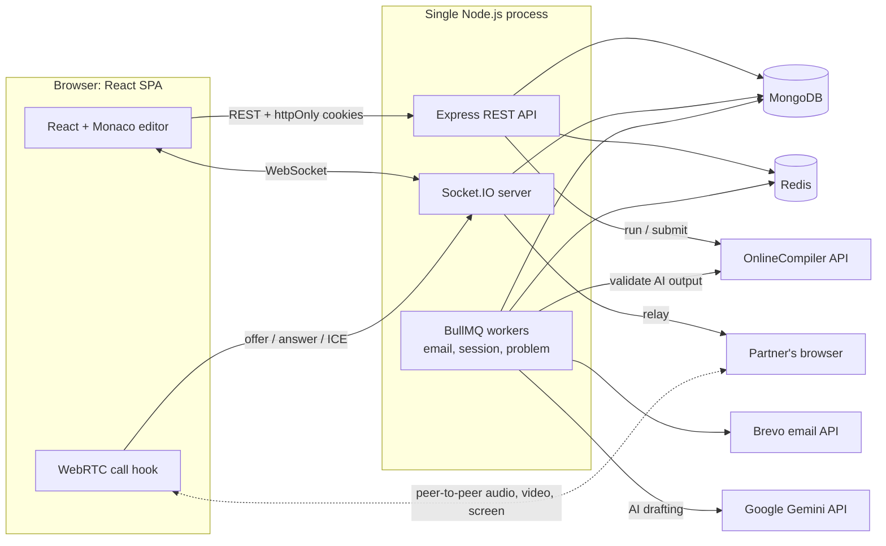
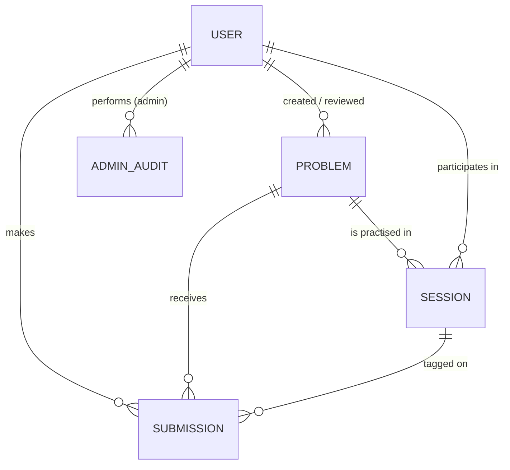
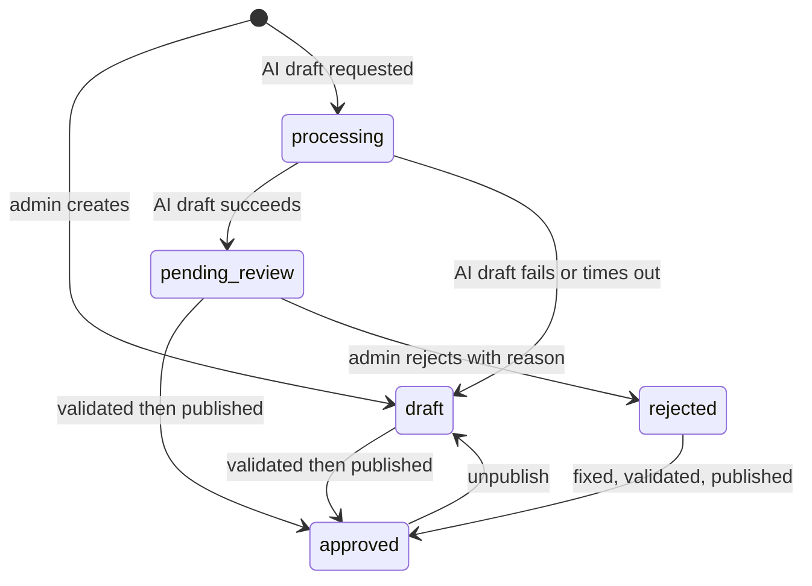
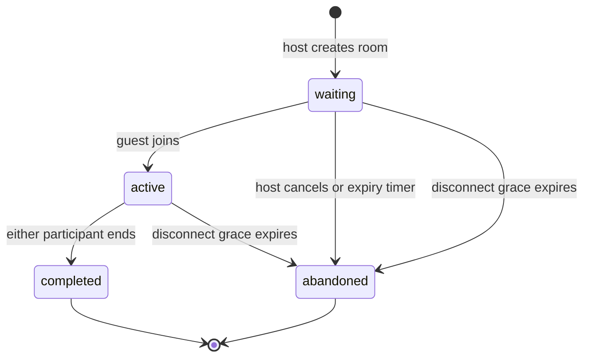

<div align="center">

# CodeNexa

**Practice coding problems solo, or run a mock technical interview with a partner, with video, chat and a judge built in.**


[Live Demo](#live-demo) · [Features](#features) · [Architecture](#architecture) · [Getting Started](#getting-started) · [API Reference](#api-reference)

</div>

---

## Table of Contents

- [Overview](#overview)
- [Features](#features)
- [Tech Stack](#tech-stack)
- [Architecture](#architecture)
- [Folder Structure](#folder-structure)
- [Getting Started](#getting-started)
- [Environment Variables](#environment-variables)
- [API Reference](#api-reference)
- [Real-Time Events (Socket.IO)](#real-time-events-socketio)
- [Database](#database)
- [Application Workflows](#application-workflows)
- [Security & Rate Limiting](#security--rate-limiting)
- [Deployment](#deployment)
- [Live Demo](#live-demo)
- [Screenshots](#screenshots)
- [Known Limitations](#known-limitations)
- [Future Improvements](#future-improvements)
- [License](#license)

---

## Overview

CodeNexa is a full-stack web application for **technical-interview practice**. It combines two things that are usually separate: a LeetCode-style problem judge and a live interview room.

- **Solo practice:** browse a curated problem set, write a solution in the in-browser Monaco editor, run it against the example cases, and submit it to be judged against hidden test cases.
- **Partner practice:** open a private (code-protected) or public room for any problem, and work through it with another person over a **WebRTC video/audio call**, with **screen sharing** and **text chat**. Submissions made inside a room are tagged to that session, and the pair can chain several problems in one sitting without the call dropping.
- **Admin tooling:** admins author, validate, review and publish problems, and can have **Google Gemini draft an entire problem** (statement, solutions, tests) from a one-line idea. Every AI-drafted problem is cross-checked by actually executing code before it can be published.

The problem it solves: interview preparation platforms usually give you either a judge *or* a way to practise talking through a problem with a human. CodeNexa puts both in one place.

---

## Features

### Practice & Judging
- **Problem library** with search, difficulty, topic and progress filters (solved / attempted / unsolved), pagination, and per-problem acceptance rate.
- **Monaco code editor** with Python, C++ and TypeScript (Deno). Drafts auto-save per problem and language in `localStorage`.
- **Run** against editable example inputs, **Submit** against example + hidden tests. Verdicts: `accepted`, `wrong_answer`, `runtime_error`, `time_limit_exceeded`, `compile_error`.
- **Hidden test cases and reference solutions never reach the client.** They are `select: false` in the schema *and* whitelisted again in the controller.
- **Submission history** per problem and a personal **dashboard** (solved ring by difficulty, timezone-aware streaks, topic and language breakdowns, recent practice labelled Solo vs Interview).

### Interview Rooms
- **Private rooms** joined by a 6-character code (e.g. `QWM473`, letters and digits chosen to avoid look-alikes) and **public rooms** listed in a live-updating lobby with filters.
- **WebRTC call:** microphone, camera and screen share, with mute/camera/screen state announced to the partner. Optional TURN support.
- **In-room chat** (relayed over Socket.IO; messages are not persisted).
- **Reconnect grace period:** if someone drops, the room waits (configurable) before being abandoned, with a banner and countdown for the partner.
- **Problem chaining:** in private rooms the host can pick the *next* problem, and both people move into a new session without re-sharing a link, keeping the call alive.
- **One open room per user**, enforced by a partial unique index in MongoDB, so two quick clicks can't create two rooms.
- **Seat takeover:** opening the same room in a second tab/device moves the seat and tells the old tab.

### Authentication & Accounts
- Email registration with a **verification link** (pending account lives only in Redis for 5 minutes, so unverified users are never written to MongoDB).
- Login with **httpOnly JWT cookies** (15-minute access token, 7-day refresh token) and transparent refresh on the client.
- **Single active session per account:** logging in elsewhere triggers a conflict prompt and a deliberate "log out the other device" takeover.
- **Password reset** via a 6-digit emailed OTP (5 attempts, 5-minute expiry) that exchanges for a short-lived reset token.

### Admin Console
- **Overview:** users, published problems by difficulty, 14-day submission chart, verdict and language breakdowns, live rooms, and "attention" items (problems awaiting review, rooms open longer than 3 hours).
- **Users:** search, filter and promote/demote roles, with guards (you can't demote yourself; at least one admin must remain).
- **Problems:** create/edit with examples, hidden tests, hints and a reference solution; **Validate**, **Publish / Unpublish**, **Reject** (with reason), **Delete** (blocked if submissions or rooms reference it).
- **AI drafting** with Gemini (see below).
- **Activity log:** append-only audit trail of admin actions.

### AI-Assisted Problem Authoring
An admin enters an idea (20–2000 chars) and optionally a difficulty. A background worker then:

1. Drafts the full statement (structured JSON output, validated with Zod, one automatic retry with the error fed back to the model).
2. Writes **two independent Python solutions**: an efficient reference and a deliberately different brute force.
3. Generates small edge-case inputs plus a **seeded test generator** for large inputs.
4. **Executes everything** on the code runner, cross-checks the two solutions, replaces example outputs that don't match what the solution really prints, drops inputs where the solutions disagree, and rejects the draft outright if they disagree on more than 25% of checked inputs or fewer than 8 usable hidden tests remain.
5. Saves the result as `pending_review` with a **report of flags** (warnings/errors/info) for the human reviewer.

---

## Tech Stack

| Layer | Technologies |
|---|---|
| **Frontend** | React 19, Vite 8, React Router 7, Tailwind CSS 4, Framer Motion, Lucide icons, `@monaco-editor/react`, `input-otp`, Axios, `socket.io-client` |
| **Backend** | Node.js (ES modules), Express 5, Socket.IO 4, Zod 4 (validation), Morgan, `cookie-parser`, `cors` |
| **Database** | MongoDB via Mongoose 9 |
| **Cache / Queues** | Redis (`redis` client) and BullMQ 6 (three queues: `email`, `session`, `problem`) |
| **Authentication** | JWT (`jsonwebtoken`) in httpOnly cookies, `bcrypt`, Redis-backed refresh sessions, role-based access control |
| **Real-time** | Socket.IO (presence, chat, lobby, signalling), browser WebRTC (`RTCPeerConnection`) |
| **External services** | [Brevo](https://www.brevo.com/) transactional email API, [OnlineCompiler](https://onlinecompiler.io/) code execution API, Google Gemini API (optional) |
| **Security libs** | `mongo-sanitize`, Zod schemas, Redis rate limiting |
| **Tooling** | ESLint 10 (frontend), `node --watch` (backend dev) |

**Supported languages:** Python (`python-3.14`), C++ (`g++-15`), TypeScript (`typescript-deno`). These are mapped in `backend/src/config/languages.js` and mirrored in `frontend/src/lib/languages.js`.

---

## Architecture



**How the pieces interact**

- **One process, two protocols.** `server.js` creates a single HTTP server shared by Express and Socket.IO, then starts the three BullMQ workers in the same process after MongoDB and Redis are connected. It also handles `SIGTERM`/`SIGINT` with a graceful shutdown (close sockets, drain workers, close queues, disconnect databases).
- **MongoDB** holds durable data: users, problems, submissions, sessions (rooms) and the admin audit log.
- **Redis** does a lot of the work: cached `req.user` (1 h), refresh-token sessions (7 d), pending registrations, OTPs, reset tokens, all rate-limit counters, and the BullMQ queues.
- **BullMQ** moves slow or time-based work off the request path: sending email (3 attempts, exponential backoff), room timers (reconnect grace and waiting-room expiry as *delayed jobs*), and AI drafting (concurrency 1, never auto-retried because it costs AI calls and code runs).
- **Socket.IO** authenticates the handshake from the `accessToken` cookie, tracks presence, and relays chat, WebRTC signalling and media state between the two people in a room. The server never touches the media; audio/video/screen go **peer-to-peer**.
- **Code execution** is delegated to the OnlineCompiler API through `executor.service.js`, which adds a concurrency limit, a per-minute budget, retries on `429`, and translates provider output into verdicts.
- **Room chains.** Every session has a `chainId`. Socket rooms are keyed by chain, not by session, which is what keeps the call connected while the host moves the pair to the next problem.

---

## Folder Structure

```text
CodeNexa/
├── backend/
│   ├── server.js                 # Entry: connects DB + Redis, starts workers, sockets, graceful shutdown
│   ├── scripts/
│   │   ├── seedAdmin.js          # Promote an existing user to admin
│   │   ├── seedProblems.js       # Idempotent import of problems from scripts/problems/*.json
│   │   ├── problems/             # 4 starter problems (Two Sum, Valid Parentheses, ...)
│   │   ├── socketTest.js         # Manual two-user socket/presence test script
│   │   └── rtcTest.js            # Manual two-user WebRTC signalling test script
│   └── src/
│       ├── app.js                # Express app, CORS, routers, error handler
│       ├── config/               # env validation, Mongo, Redis/BullMQ connection, language map
│       ├── controllers/          # auth, problem, submission, session, dashboard, admin.*
│       ├── routes/               # auth, problems, sessions, dashboard, admin
│       ├── middlewares/          # auth (JWT + Redis cache), RBAC, Zod validate, error handler
│       ├── validators/           # Zod schemas
│       ├── models/               # user, problem, submission, session, adminAudit
│       ├── services/             # executor, judge, gemini, aidraft, problempipeline, session, presence, email
│       ├── jobs/
│       │   ├── queues/           # email, session (grace/expiry), problem (AI draft)
│       │   └── workers/
│       ├── sockets/              # Socket.IO server (index.js) and emit helpers (io.js)
│       └── utils/                # rate limiter, tokens, cookies, OTP, room codes, fingerprint, audit log...
│
└── frontend/
    ├── index.html
    ├── vite.config.js            # React + Tailwind (Vite plugin)
    ├── .env.development          # VITE_SERVER_URL=http://localhost:3000
    ├── .env.production           # placeholder backend URL
    └── src/
        ├── App.jsx               # Lazy-loaded routes + Protected/Guest/Admin route guards
        ├── api/                  # Axios instance (silent token refresh) and API modules
        ├── context/              # AuthContext, SocketContext
        ├── hooks/                # useCall (WebRTC), useLobby, useJoinRoom, useProblemRunner, ...
        ├── components/           # Layout, Navbar, route guards, shared UI
        └── pages/
            ├── auth/             # Login, Register, Verify, Forgot/Reset password
            ├── home/             # Landing page
            ├── problems/         # List + problem workspace (editor, tests, results, partner practice)
            ├── rooms/            # Public room lobby + join-by-code
            ├── session/          # Interview room (call, chat, screen view, waiting room, ...)
            ├── dashboard/        # Personal stats
            ├── admin/            # Overview, Users, Problems, Activity, problem form/review
            └── submit/           # "Coming soon" placeholder
```

---

## Getting Started

### Prerequisites

| Requirement | Notes |
|---|---|
| **Node.js** | **22.13+ recommended** (20.19+ is the minimum required by Vite 8 and Mongoose 9) |
| **MongoDB** | Local instance or MongoDB Atlas |
| **Redis** | Local instance or a managed Redis. Required, as the server exits on startup without it |
| **Brevo account** | API key and a verified sender email. Required: verification and reset emails are the only way to activate an account |
| **OnlineCompiler API key** | Required for Run / Submit and for admin Validate |
| **Gemini API key** | *Optional.* Only needed for AI problem drafting |

### 1. Clone

```bash
git clone https://github.com/RK07-bot/CodeNexa.git
cd CodeNexa
```

### 2. Backend

```bash
cd backend
npm install
```

Create `backend/.env` (full reference in [Environment Variables](#environment-variables)):

```env
PORT=3000
NODE_ENV=development
APP_NAME=CodeNexa
FRONTEND_URL=http://localhost:5173

MONGO_URI=mongodb://127.0.0.1:27017/codenexa
REDIS_URL=redis://127.0.0.1:6379

ACCESS_JWT_SECRET=<long-random-string>
REFRESH_JWT_SECRET=<a-different-long-random-string>

BREVO_API_KEY=<your-brevo-api-key>
BREVO_SENDER_EMAIL=<verified-sender@example.com>

ONLINECOMPILER_API_KEY=<your-onlinecompiler-key>

RECONNECT_GRACE_SECONDS=60
WAITING_ROOM_EXPIRY_MINUTES=30

# Optional: AI problem drafting
# GEMINI_API_KEY=<your-gemini-key>
# GEMINI_MODEL=<primary-model-name>
# GEMINI_FALLBACK_MODEL=<fallback-model-name>
```

Generate strong secrets with:

```bash
node -e "console.log(require('crypto').randomBytes(64).toString('hex'))"
```

Start the API (the BullMQ workers start inside the same process):

```bash
npm run dev      # node --watch server.js
# or
npm start        # node server.js
```

You should see `MongoDB Connected`, `Redis Connected`, then `Server is running on port 3000`.

### 3. Frontend

In a second terminal:

```bash
cd frontend
npm install
npm run dev
```

The app is served by Vite at **http://localhost:5173**. `frontend/.env.development` already points `VITE_SERVER_URL` at `http://localhost:3000`.

### 4. Create your first admin and seed problems

1. Register in the UI and click the verification link from the email.
2. Promote that account and import the starter problems:

```bash
cd backend
node scripts/seedAdmin.js you@example.com      # sets role = admin
node scripts/seedProblems.js you@example.com   # imports + publishes the 4 problems in scripts/problems/
```

`seedProblems.js` is idempotent: running it again updates problems (matched by slug) instead of duplicating them.

> After changing a role directly in the database, log out and back in (or wait for the 1-hour user cache to expire) so the new role is picked up. Role changes made through the admin UI invalidate the cache automatically.

### Useful scripts

| Location | Command | Purpose |
|---|---|---|
| `backend` | `npm run dev` / `npm start` | Run the API with or without file watching |
| `backend` | `node scripts/seedAdmin.js <email>` | Grant admin to an existing user |
| `backend` | `node scripts/seedProblems.js <adminEmail>` | Import starter problems |
| `backend` | `node scripts/socketTest.js <emailA> <passA> <emailB> <passB>` | Manual end-to-end socket test |
| `backend` | `node scripts/rtcTest.js <emailA> <passA> <emailB> <passB>` | Manual WebRTC signalling test |
| `frontend` | `npm run dev` / `npm run build` / `npm run preview` | Dev server / production build / preview build |
| `frontend` | `npm run lint` | ESLint |

> The two test scripts log in with `force: true`, which signs those accounts out of any other device. Use throwaway accounts.

---

## Environment Variables

### Backend (`backend/.env`)

The server validates variables at startup (`src/config/env.js`) and **throws if a required one is missing**.

| Variable | Required | Description | Example placeholder |
|---|:--:|---|---|
| `PORT` | ✅ | Port for Express and Socket.IO | `3000` |
| `NODE_ENV` | ✅ | `development` or `production`. In production, cookies are `Secure` + `SameSite=None` | `development` |
| `APP_NAME` | ✅ | App name; default Brevo sender name | `CodeNexa` |
| `FRONTEND_URL` | ✅ | Exact frontend origin. Used for **CORS** (REST and Socket.IO) and in email links | `http://localhost:5173` |
| `MONGO_URI` | ✅ | MongoDB connection string | `mongodb://127.0.0.1:27017/codenexa` |
| `REDIS_URL` | ✅ | Redis URL. **Include the port**; a `rediss://` URL enables TLS for BullMQ | `redis://127.0.0.1:6379` |
| `ACCESS_JWT_SECRET` | ✅ | Secret for 15-minute access tokens | `<random-string>` |
| `REFRESH_JWT_SECRET` | ✅ | Secret for 7-day refresh tokens (use a different value) | `<random-string>` |
| `BREVO_API_KEY` | ✅ | Brevo transactional email API key | `<brevo-api-key>` |
| `BREVO_SENDER_EMAIL` | ✅ | Verified sender address in Brevo | `no-reply@example.com` |
| `BREVO_SENDER_NAME` | ➖ | Sender display name (defaults to `APP_NAME`) | `CodeNexa` |
| `ONLINECOMPILER_API_KEY` | ✅ | OnlineCompiler API key | `<onlinecompiler-key>` |
| `ONLINECOMPILER_DEBUG` | ➖ | Parsed into config (`"true"` → boolean), but nothing in the repo currently reads it | `false` |
| `RECONNECT_GRACE_SECONDS` | ✅ | How long a disconnected participant has to return before the room is abandoned (falls back to `60` if not numeric) | `60` |
| `WAITING_ROOM_EXPIRY_MINUTES` | ✅ | How long an unjoined room stays open (falls back to `30` if not numeric) | `30` |
| `GEMINI_API_KEY` | ➖ | Enables AI problem drafting. If empty, the AI-draft endpoints return `503` | `<gemini-api-key>` |
| `GEMINI_MODEL` | ➖ | Primary Gemini model for drafting. Needed whenever AI drafting is used | `<model-name>` |
| `GEMINI_FALLBACK_MODEL` | ➖ | Used after the primary model exhausts its retries | `<model-name>` |
| `ICE_SERVERS` | ➖ | JSON array of ICE servers served by `GET /api/sessions/rtc/config`. Defaults to public Google/Cloudflare STUN. See [Known Limitations](#known-limitations) | `[{"urls":["stun:stun.l.google.com:19302"]}]` |

### Frontend (`frontend/.env.*`)

Vite bakes these in at **build time**.

| Variable | Required | Description | Example placeholder |
|---|:--:|---|---|
| `VITE_SERVER_URL` | ✅ in prod | Backend base URL (no trailing slash needed). Defaults to `http://localhost:3000` | `https://api.example.com` |
| `VITE_TURN_URL` | ➖ | TURN server URL(s), comma-separated. Needed for users behind strict NATs/firewalls | `turn:turn.example.com:3478` |
| `VITE_TURN_USERNAME` | ➖ | TURN username | `<turn-user>` |
| `VITE_TURN_CREDENTIAL` | ➖ | TURN credential | `<turn-password>` |

> Never commit real secrets. The repository's `.gitignore` already excludes `.env` and `.env.*`. There is currently no committed `.env.example`; the blocks above are the reference.

---

## API Reference

**Base URL:** `http://localhost:3000/api`

- All request/response bodies are JSON. Successful responses include `"success": true` (except where noted).
- **Auth** is cookie-based: `accessToken` and `refreshToken` httpOnly cookies are set on login. Clients must send credentials (`withCredentials: true` in Axios).
- Validation failures return `400` with `{ "success": false, "message": "validation error", "errors": { "<field>": ["..."] } }`.
- 🔓 = public · 🔑 = logged-in user · 🛡️ = admin only

### Auth (`/api/auth`)

| Method | Endpoint | Access | Body / Params | Description |
|---|---|:--:|---|---|
| `POST` | `/register` | 🔓 | `username` (≥3), `email`, `password` (≥8) | Stages the account in Redis and emails a verification link (valid 5 min). Returns a generic message to avoid revealing registered emails |
| `GET` | `/verify/:token` | 🔓 | `token` in path | Consumes the token and creates the user in MongoDB |
| `POST` | `/resend-verification` | 🔓 | `email` | Replaces the pending token and re-sends the email (60 s cooldown, 3 per 5 min) |
| `POST` | `/login` | 🔓 | `email`, `password`, `force?` (boolean) | Sets auth cookies. Returns `409` with `sessionConflict: true` and the existing device info if the account is already logged in elsewhere; resend with `force: true` to take over |
| `POST` | `/refresh` | 🍪 refresh cookie | none | Rotates both tokens (validated against the Redis-stored refresh token) |
| `POST` | `/logout` | 🔑 | none | Revokes the refresh session, clears cookies and the user cache |
| `GET` | `/me` | 🔑 | none | Current user (`username`, `email`, `role`) |
| `POST` | `/forgot-password` | 🔓 | `email` | Emails a 6-digit OTP (same response whether or not the account exists) |
| `POST` | `/resend-otp` | 🔓 | `email` | Issues a fresh OTP and resets the attempt counter |
| `POST` | `/verify-otp` | 🔓 | `email`, `otp` (6 digits) | Returns a short-lived `resetToken` (5 min) |
| `POST` | `/change-password` | 🔓 (reset token) | `resetToken`, `newPassword` (≥8), `confirmNewPassword` | Sets the new password and revokes existing sessions |

### Problems (`/api/problems`), 🔑 all routes

| Method | Endpoint | Description |
|---|---|---|
| `GET` | `/` | Paginated list of **approved** problems. Query: `search`, `difficulty` (`easy\|medium\|hard`), `topic`, `progress` (`solved\|attempted\|unsolved`), `page`, `limit` (≤50). Each item includes the caller's progress and the acceptance rate |
| `GET` | `/topics` | Distinct topics of approved problems |
| `GET` | `/:slug` | Full problem statement (no hidden tests, no reference solution) plus `solved` and `acceptanceRate` |
| `POST` | `/:slug/run` | Body: `language`, `code` (≤50 000 chars), `inputs?` (1–3 strings, defaults to the examples). Runs the code and returns per-input `stdout`, `stderr`, `status` and, for example inputs, `expected`/`passed`. 20 runs/min/user |
| `POST` | `/:slug/submit` | Body: `language`, `code`, `session?` (room code). Judges against examples + hidden tests, stores a submission, updates problem and room stats. 10 submits/min/user. Returns `verdict`, `passed`, `total`, `failedTest` and, on failure, a `detail` object: `stderr` for compile/runtime errors, or input/expected/actual for a wrong answer on a public **example** only (hidden test data is never revealed) |
| `GET` | `/:slug/submissions` | Caller's last 20 submissions for the problem (code omitted) |

`language` must be one of `python`, `cpp`, `typescript`. Execution outages return `503`.

### Sessions / Rooms (`/api/sessions`), 🔑 all routes

| Method | Endpoint | Description |
|---|---|---|
| `POST` | `/` | Create a room. Body: `problem` (slug), `visibility` (`private\|public`). `409` + `alreadyInRoom` if the user already has an open room |
| `GET` | `/public` | Paginated public, open rooms. Query: `problem`, `status` (`waiting\|active`), `difficulty`, `search`, `page`, `limit` |
| `GET` | `/me/current` | The caller's open room, or `null` |
| `GET` | `/rtc/config` | ICE server list. Only available to someone who is in an open room (`403` otherwise) |
| `GET` | `/:code` | Room details. Participant-only fields (members, stats, chain info) are included only for members |
| `POST` | `/:code/join` | Join as guest. Atomic: succeeds only while the room is `waiting` with one participant. Re-opening your own room returns `rejoined: true` |
| `POST` | `/:code/cancel` | Host cancels a `waiting` room |
| `POST` | `/:code/end` | Either participant ends an `active` session (it ends for both) |
| `POST` | `/:code/next` | Host of a **private**, `completed` room starts the next problem. Body: `problem` (slug). Both participants are moved into a new `active` session in the same chain |

Room code lookups and joins are rate limited to 20 per minute per user, since private rooms are protected only by their code.

### Dashboard (`/api/dashboard`), 🔑

| Method | Endpoint | Description |
|---|---|---|
| `GET` | `/?tz=<IANA timezone>` | Solved counts by difficulty (vs. totals), attempting count, rooms completed (total and this month), current and best streak, language usage, topic counts, 10 most recent submissions. `tz` makes "today" and "this month" match the user's calendar |

### Admin (`/api/admin`), 🛡️ all routes

Every route passes through `isAuthenticated` + `requireAdmin`.

| Method | Endpoint | Description |
|---|---|---|
| `GET` | `/overview?tz=` | Platform stats: users, problems, 14-day submissions, verdicts, languages, live rooms, stuck rooms |
| `GET` | `/activity` | Audit log. Query: `targetType` (`user\|problem\|session`), `page`, `limit` |
| `GET` | `/users` | Paginated users with solved/submission counts. Query: `search`, `role`, `page`, `limit` |
| `PATCH` | `/users/:userId/role` | Body: `role` (`user\|admin`). Cannot demote yourself or the last admin |
| `GET` | `/problems` | Paginated problems of any status, plus per-status counts |
| `GET` | `/problems/topics` | Distinct topics across all statuses |
| `POST` | `/problems` | Create a problem as a `draft` |
| `GET` | `/problems/:id` | Full problem including hidden tests and reference solution |
| `PUT` | `/problems/:id` | Update. Rejected with `409` while the problem is published or `processing`. Invalidates a stale validation automatically |
| `POST` | `/problems/ai-draft` | Body: `idea` (20–2000 chars), `difficulty?`. Queues a Gemini draft; `202` on success, `429` if 3 are already running, `503` if AI isn't configured |
| `POST` | `/problems/:id/regenerate` | Re-run AI drafting from the same idea |
| `POST` | `/problems/:id/validate` | Runs the reference solution against **all** examples and hidden tests (max 60) and records a validation fingerprint if everything passes |
| `POST` | `/problems/:id/reject` | Body: `reason` (3–500 chars). Only for `pending_review` problems |
| `PATCH` | `/problems/:id/status` | Body: `status` (`approved\|draft`). Publishing requires a validation that still matches the current tests/solution |
| `DELETE` | `/problems/:id` | Blocked while published, or if any submission or room references the problem |

---

## Real-Time Events (Socket.IO)

The socket handshake is authenticated from the `accessToken` cookie. If the token has expired, the client refreshes it and reconnects automatically (rate-limited to once per 30 s).

| Event | Direction | Purpose |
|---|---|---|
| `room:join` `{ roomCode }` | client → server | Join the room's *chain* channel, mark presence, take over the seat from any other tab (ack: `{ ok }`) |
| `room:leave` | client → server | Leave the room; starts the reconnect grace period if no other tab remains |
| `room:taken-over` | server → client | This tab lost its seat to another tab/device |
| `presence:update` | server → room | Who is connected, plus the grace-period length |
| `session:updated` | server → room | Status changed (joined, ended, cancelled, abandoned) |
| `session:next` | server → room | Host started the next problem in the chain |
| `lobby:subscribe` / `lobby:unsubscribe` | client → server | Opt in/out of lobby refresh notifications |
| `lobby:changed` | server → lobby | The public room list changed; clients refetch it |
| `chat:send` `{ text }` | client → server | 1–500 chars, 15 messages per 10 s. Username comes from the login, never the client |
| `chat:message` | server → room | A chat message |
| `rtc:ready` | both | Ask the partner to (re)start a call |
| `rtc:signal` | both | WebRTC offer/answer/ICE. Payloads are re-built field-by-field and size-capped before being relayed |
| `media:state` | both | `{ audio, video, screen }` so each side can show the partner's mic/camera/screen state |

---

## Database

MongoDB with five Mongoose models.



| Model | Key fields | Notes |
|---|---|---|
| **User** | `username` (unique), `email` (unique), `password` (bcrypt hash), `role` (`user`/`admin`) | There is no "verified" flag: accounts are only created *after* verification |
| **Problem** | `title`, `slug` (unique, sparse), `description`, `constraints`, `inputFormat`, `outputFormat`, `difficulty`, `topics[]`, `hints[]`, `timeLimit` (1–10 s), `memoryLimit` (64–512 MB), `examples[]`, `testCases[]`, `referenceSolution`, `status`, `validation`, `ai`, `stats` | `testCases` and `referenceSolution` are `select: false`. Required fields are only enforced once a problem leaves `draft`/`processing` |
| **Submission** | `user`, `problem`, `language`, `code`, `verdict`, `passed`, `total`, `session?` | Indexed by `user + problem + createdAt` for history and solved/attempted status |
| **Session** | `roomCode` (unique), `problem`, `problemInfo` (denormalised title/slug/difficulty), `visibility`, `participants[]` (user, username, role, connected, disconnectedAt), `status`, `open`, `endReason`, `chainId`, `previousSession`, `nextRoomCode`, `stats` | Partial unique index on `participants.user` where `open: true` guarantees one open room per person |
| **AdminAudit** | `actor`, `actorUsername`, `action`, `targetType`, `targetId`, `targetLabel`, `details` | Create-only (no `updatedAt`). Actor name is copied at write time |

**Problem lifecycle**



**Session lifecycle**



**Data in Redis (ephemeral)**

| Key pattern | Purpose | TTL |
|---|---|---|
| `verify:<token>`, `pending-token:<email>` | Unverified registration data | 5 min |
| `refresh-token:<userId>` | The user's single active session (refresh token, device label, login time) | 7 days |
| `user:<userId>` | Cached `username/email/role` for auth middleware | 1 hour |
| `forgot-password-otp:<email>`, `forgot-password-attempts:<email>`, `password-reset:<token>` | Password reset flow | 5 min |
| `register-ip:*`, `login-ip:*`, `run:*`, `submit:*`, `chat:*`, ... | Rate-limit counters | per window |
| BullMQ keys | `email`, `session`, `problem` queues | n/a |

---

## Application Workflows

### Sign-up and login
1. `POST /auth/register` stores the hashed password and details in Redis and queues a verification email.
2. The user opens `FRONTEND_URL/verify/<token>`, the page calls `GET /auth/verify/:token`, and the account is created in MongoDB.
3. `POST /auth/login` checks credentials, rate limits (10/15 min per IP, 5/15 min per email), and detects an existing session. If one exists the UI shows a conflict dialog; confirming re-sends with `force: true` and the old device's refresh token is overwritten.
4. When an access token expires, the Axios interceptor calls `/auth/refresh` once (concurrent failed requests are queued behind that single refresh) and replays the original request. If refresh fails, the app logs the user out.

### Solving a problem
1. Open a problem, pick a language, write code (auto-saved locally).
2. **Run** executes the code on the example inputs (editable) and shows output, stderr and pass/fail where an expected answer is known.
3. **Submit** judges the code against examples then hidden tests, **stopping at the first failure**, running two tests at a time. The verdict and counts are stored and problem statistics are updated. Output comparison ignores trailing whitespace and trailing blank lines.

### Running an interview room
1. From a problem page (or the Rooms page) the host **creates** a private or public room. A waiting-room expiry timer is scheduled.
2. A guest **joins** by code or from the public lobby. The join is a single atomic update, so only one guest can take the seat.
3. Both open `/session/:code`: the socket joins the room channel, presence is broadcast, and the browsers negotiate a WebRTC call. The participant with the alphabetically smaller username creates the offer. Microphone, camera and screen sit in fixed transceiver "slots", so toggling any of them swaps a track instead of renegotiating.
4. Each person solves in their **own** editor. Submissions made in the room carry the room code and count towards the session stats. Screen sharing lets the partner watch someone else's editor.
5. If someone drops, a delayed BullMQ job gives them `RECONNECT_GRACE_SECONDS` to return; otherwise the room is marked `abandoned`. After a server restart, `reconcilePresence()` re-arms those timers for anyone still marked as connected.
6. Either person can **end** the session. In a private room the host can then pick the **next problem**, which creates a new session in the same chain and keeps the call connected.

### Publishing a problem (admin)
1. Create a draft by hand, or enter an idea and let the AI pipeline draft it.
2. Review the statement, examples, hidden tests, reference solution and (for AI drafts) the report of flags.
3. Press **Validate**: the reference solution is run against every example and hidden test. On success the server stores a **SHA-256 fingerprint** of the examples, tests, solution and limits.
4. **Publish** is only allowed when the stored fingerprint matches the current content. Any later edit that changes those inputs clears the validation. Published problems must be unpublished before they can be edited or deleted, so earlier verdicts never become inconsistent.
5. Each important step is written to the audit log.

---

## Security & Rate Limiting

- Passwords hashed with **bcrypt**; JWTs live only in **httpOnly** cookies (`Secure` + `SameSite=None` in production, `Lax` in development).
- **Refresh tokens are validated against Redis**, so logout, password change and single-session takeover revoke them immediately.
- Request bodies validated with **Zod**; auth bodies additionally pass through **`mongo-sanitize`**; user-supplied search text is regex-escaped; JSON body limit is 1 MB.
- **Role-based access control** on the whole admin router; non-admins are redirected away on the client, and enforced independently on the server.
- Enumeration-resistant responses for registration, forgot-password and resend-OTP.
- **CORS** is restricted to the single configured `FRONTEND_URL`; `trust proxy` is set to `1` for deployment behind one reverse proxy.
- Socket payloads: 256 KB max buffer, per-socket in-memory limits (200 code-events/s, 100 RTC events/s), signalling messages are sanitised and size-capped, and chat usernames are server-assigned.

| Action | Limit |
|---|---|
| Register | 3 / 10 min per IP; 1 pending email per 5 min |
| Resend verification | 60 s cooldown; 3 / 5 min per email |
| Login | 10 / 15 min per IP; 5 / 15 min per email |
| Forgot password / resend OTP | 5 / 5 min per email; 3 / 5 min per email + 5 / 15 min per IP |
| Verify OTP | 10 / 15 min per IP; 5 wrong attempts invalidates the OTP |
| Run / Submit code | 20 / min and 10 / min per user |
| Create room | 5 / min per user |
| Room lookup / join | 20 / min per user |
| Chat | 15 messages / 10 s per user |
| Concurrent AI drafts | 3 |

---

## Deployment

The repository does **not** include a Dockerfile, CI workflow or platform-specific config (no `vercel.json`, `render.yaml`, `Procfile`, etc.). The notes below follow from how the code is written.

**Backend**
- Deploy as a **long-running Node.js process** (not serverless): it hosts WebSocket connections, BullMQ workers and in-process timers.
- Provide MongoDB and Redis. TLS Redis (`rediss://`) is supported; include the port in `REDIS_URL`.
- Set all [required variables](#environment-variables), with `NODE_ENV=production`, and `PORT` (the server binds `0.0.0.0`).
- The frontend and API will usually be on **different origins**. Production cookies are `SameSite=None; Secure`, so both must be served over **HTTPS**, and `FRONTEND_URL` must match the frontend origin exactly.
- Put it behind one reverse proxy/load balancer (`trust proxy` is `1`) that supports WebSocket upgrades.
- Run **one instance** for now (see [Known Limitations](#known-limitations)).
- `npm start` is the production command.

**Frontend**
```bash
cd frontend
# set VITE_SERVER_URL (and optional VITE_TURN_*) in .env.production or the host's build env
npm run build        # outputs frontend/dist
```
Serve `dist/` from any static host. Because the app uses `BrowserRouter`, configure the host to **fall back to `index.html`** for unknown paths (e.g. `/problems/two-sum`, `/session/ABC234`).

---

## Live Demo

> 🔗 **Live URL:** _add your deployed frontend URL here_
> 🔗 **API URL:** _add your deployed backend URL here_

---

## Screenshots

> Add images to a `docs/screenshots/` folder and update the paths below.

| Landing page | Problem workspace |
|---|---|
|  |  |

| Interview room | Dashboard |
|---|---|
|  |  |

| Admin overview | AI problem review |
|---|---|
|  |  |

---

## Known Limitations

Documented here so the README reflects what the code does today.

- **No shared live editor.** The server relays `code:update`, `code:sync-request` and `code:sync-reply` events, but the current frontend does not use them. Each participant edits their own code; collaboration happens through the call, chat and screen sharing.
- **AI is used for authoring only.** Gemini drafts problems for admins. There is no AI feedback on user submissions, even though the landing page copy mentions it.
- **User problem submission is not built.** `/submit` is a "Coming soon" page. (The `pending_review` status exists in the model and is used by the AI pipeline.)
- **Memory limit is stored but not enforced.** The execution provider cannot take a memory limit; only the time limit is checked (against the provider-reported run time, excluding compilation).
- **TURN/ICE configuration is split.** The call hook in the browser builds its ICE list from public STUN plus `VITE_TURN_*`. The backend's `ICE_SERVERS` and `GET /api/sessions/rtc/config` exist but are not currently consumed by the frontend, so set TURN via the `VITE_TURN_*` variables.
- **Single-instance design.** Socket.IO has no Redis adapter, and the executor's concurrency/per-minute throttling is held in process memory, so running multiple backend instances would need changes.
- **Execution throughput is bounded by the provider plan.** The executor is coded for 2 concurrent runs and 28 runs per minute.
- **No automated tests** (the backend `test` script is a placeholder). `socketTest.js` and `rtcTest.js` are manual scripts.
- The audit-log enum includes `session.force_ended`, but no endpoint currently produces it.

---

## Future Improvements

Realistic next steps that build on what already exists:

- **Collaborative editing:** wire the existing `code:*` socket relay into the Monaco editor (e.g. with a CRDT such as Yjs) so a partner can follow along live.
- **AI feedback on submissions:** reuse the Gemini service for hints and post-submission review.
- **Community problem submissions:** build the user-facing flow on top of the existing `pending_review` / reject-with-reason moderation path.
- **Horizontal scaling:** add the Socket.IO Redis adapter and move executor throttling into Redis.
- **Self-hosted sandbox** (e.g. Judge0 or Piston) to remove third-party rate limits and enforce memory limits.
- **Single source of truth for ICE servers:** have the client fetch `/api/sessions/rtc/config` instead of maintaining separate frontend variables.
- **Testing and CI:** unit tests for the judge, pipeline and validators (the AI draft service already accepts injected dependencies), plus a GitHub Actions workflow.
- **Containerisation:** Dockerfiles and a `docker-compose.yml` with MongoDB and Redis for one-command local setup, and a committed `backend/.env.example`.
- **Hardening:** HTTP security headers (e.g. Helmet) and structured logging.
- **More languages** by extending the language map on both the backend and frontend.

---

## License

No license file is currently included in this repository. Add a `LICENSE` file (for example MIT) and update this section before inviting contributions.

---

<div align="center">

Built by [@RK07-bot](https://github.com/RK07-bot)

</div>
